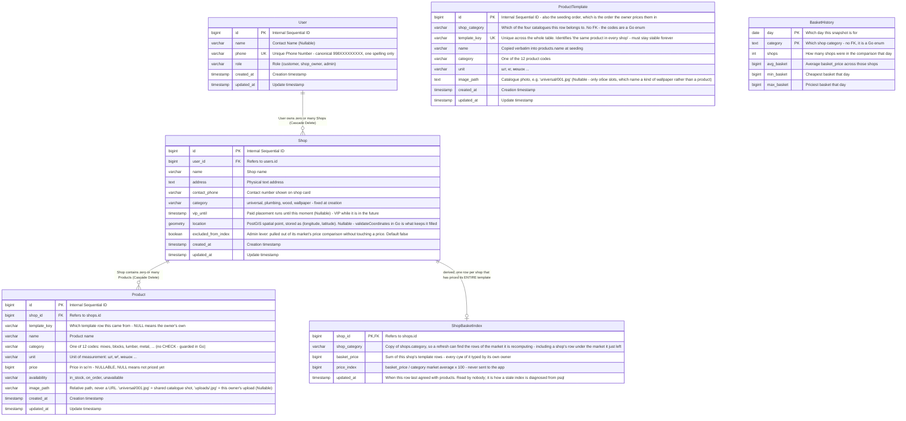

# Database

## Database Structure



## Database system design

### Connection pool

Our server-database communication is designed around *connection pool*, which is configured (inside backend/cmd/api/main.go - func mustConnectDB) the following way:
```go
config.MaxConns = envInt("DB_MAX_CONNS", 10) // max connections pool holds
config.MinConns = envInt("DB_MIN_CONNS", 2)  // minimum ready to use connetion, avoid cold-start latency
config.MaxConnLifetime = time.Hour           // connection that's been used longer than 1 hour should be cleaned
config.MaxConnIdleTime = 30 * time.Minute    // every connection that was not used at all gets cleaned
config.HealthCheckPeriod = time.Minute		 // every minute check on the connections and remove "bad" ones
```
Connection pool holds several ready to use connection to the database, creating a connection to the db takes time and effort, hence it is not very efficient, that is the reason it exists.

### Context ctx

In our backend we have a concept called "Context" AKA ctx, which is designed to signal that an operation should stop — either because it's been running too long, or because whoever asked for it gave up — so the code holding a connection can release it back to the pool instead of hanging onto it. We implemented our own ctx (func WithTimeout) inside backend/internal/dbctx/dbctx.go. Which takes a parent context and wraps around it adding a 5 second timer, this is the maximum time any sqlc-generated query is allowed to run before it's forced to stop and return an error

Parent context in this function means that we need to pass it an existing ctx which can be taken in two ways:
1. From incoming http requests (which are not timers, but rather guards that watch whether user e.g turned off his internet or left the app).
2. Or create ourselfs by using context.Background()

<br>
<br>
<br>
<br>
<br>
<br>


# Auth

**Current flow: the telegram bot handshake.** Every sign-in - the app, the `/admin` panel - and the
`/delete-account` page go through `@domix_manager_bot`. Telegram hands us the user's phone number,
which Telegram itself has verified, so there is no code, no sms and nothing to pay for.

The six-digit Telegram Gateway code flow (`POST /api/auth/request-code`, `/api/auth/verify`,
`internal/verify`, `auth.CodeManager`) is **still in the code and still routed, but no screen calls it**.
Gateway needs a $100 balance; the day that is paid, those are how the project switches back. Keeping
them is a founder decision against the delete-dead-code rule - do not tidy them away.

## SessionManager

Our authentication works around the `SessionManager` struct (`backend/internal/auth/session.go`),
which contains two `sync.Map`s. One, called `sessions`, links a session id to `SessionData` - the name,
role and language the Flutter app sent, the purpose, and once it is finished, the outcome. The other,
`chatToSession`, links a telegram chat id to a session id, so we know whose session a contact shared in
that chat belongs to. We use `sync.Map` to avoid race conditions (two or more goroutines - e.g. from
http requests - writing into one shared container at once). The steps that must happen exactly once use
its atomic operations: a contact *claims* a session with `LoadAndDelete` on the chat link plus a
`CompareAndSwap` on the session, and a poll *collects* a finished session with `LoadAndDelete`, so a
token is handed out once.

A cleanup goroutine wakes up every minute. Any session older than its expiry - 10 minutes for one
nobody finished, 2 minutes after it finished for one nobody collected - is deleted. A user stuck in the
telegram chat without sending a phone number therefore leaves an orphaned `chatToSession` entry (a chat
id pointing to a session that no longer exists), so the same goroutine cleans that up right after.
**A panic in that goroutine would take the whole api down**, so each sweep recovers, like
`startBasketHistory`. On top of that, at most 20 000 sessions can be live at once, which bounds what a
flood of `/api/auth/init` calls can hold in RAM.

Every session has a **purpose**, login or deletion. A deletion session never mints a token, and asking
`/api/auth/status` about a deletion session id answers exactly like asking about an unknown one - this
is what stops a deletion confirmation being spent as a login.

## The flow

1. The user picks a language, accepts the policy, types their name and picks a role, then presses
   «Зарегистрироваться через Telegram». One button for both signing in and registering, because the
   server finds or creates the account either way (`upsertUser`).
2. The app hits `POST /api/auth/init` with `{name, role, lang}`.
3. The backend generates a random session id (32 bytes, base64url - telegram's `start=` parameter
   allows 64 characters of `[A-Za-z0-9_-]` and silently drops anything else) and stores it:
```go
m.sessions.Store(id, SessionData{
	Purpose:   HandshakeLogin,
	Status:    SessionPending,
	Name:      name,
	Role:      role,
	Lang:      lang,
	expiresAt: m.now().Add(SessionTTL),
})
```
4. The backend answers with the session id and `https://t.me/domix_manager_bot?start=<id>`. The app
   opens that link; Telegram shows the bot, and pressing Start sends `/start <id>` to our webhook
   (`POST /api/telegram/webhook`), with our secret in the `X-Telegram-Bot-Api-Secret-Token` header -
   the webhook is a public url, and a call without the secret is refused.
5. Using `chatToSession`, the backend links that chat id to the session id, then answers in the
   session's language with a one-time keyboard holding a single **request-contact** button.
6. The user presses it, and telegram posts a `contact` to the webhook. **The backend checks that
   `contact.user_id` equals `from.id`** - without it anyone could forward somebody else's contact card
   and sign in as them.
7. The number goes through `auth.CanonicalPhone`. We look the user up: found, we log in (a role only
   goes up, customer → shop owner; the name is updated if they typed a new one); not found, we sign
   them up. Then we mint the JWT exactly as `/api/auth/verify` does and put it on the session.
8. All this time the app has been polling `POST /api/auth/status` every 2 seconds - and once more the
   moment it comes back from Telegram to the foreground. When the answer is `success` it saves the
   token and the flow closes. It gives up when the 10 minutes are over.

The `/delete-account` page is the same handshake with the deletion purpose (`POST
/api/account-deletion/start`, then `POST /api/account-deletion/status`): the bot's button reads
«Подтвердить удаление», and the account on the shared number - its shops, products and photos - is
deleted. The `/admin` panel signs in through the login handshake with no name, so an existing account is
not renamed; it works through the ssh tunnel because only telegram's webhook needs the public address.

Changing the phone number was removed: the number is the one Telegram verified, and a different number
is a different account.

<br>
<br>
<br>
<br>
<br>
<br>


# LOCAL TESTING

- TRUNCATE TABLE users RESTART IDENTITY CASCADE;
- ngrok http --url=jeep-prepay-penholder.ngrok-free.dev 8080
- go run ./cmd/api
- point the bot at the tunnel, once per tunnel url (the secret is `TELEGRAM_WEBHOOK_SECRET` from `.env`):
  `curl -s "https://api.telegram.org/bot$TELEGRAM_BOT_TOKEN/setWebhook" -d url=https://jeep-prepay-penholder.ngrok-free.dev/api/telegram/webhook -d secret_token=$TELEGRAM_WEBHOOK_SECRET -d 'allowed_updates=["message"]'`
- make apk-test
