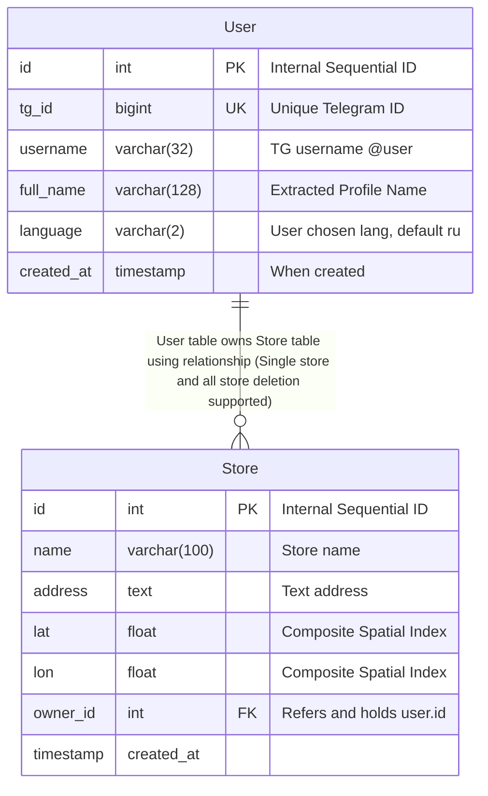

### Database Architecture

This is the Entity-Relationship Diagram (ERD) mapping the core tables in the Domix database.

### Auth via telegram bot
1. User presses "Verify through telegram" button in flutter app.
2. Flutter app generates a unique session id (https://t.me/domix_manager_bot?start=session_12345)
- The phone detects the t.me link and automatically opens the native Telegram app directly to our bot.
- The Telegram app hides the ?start=session_12345 part from the UI, but it saves it in memory.
- When the user taps the "Start" button at the bottom of the chat, Telegram automatically formats a hidden command and fires it to our Go backend via the ngrok webhook:
"/start session_12345"
- Our backend gets chatid and session id, after user sends phone number to our telegram bot, telegram sends chatid and phone number and this way we can identify from which chat we got the phone number and wanted flutter app.

### Things to fix.
1. After registration through telegram completes, user can keep spamming /start and phone number button, we need to fix that.