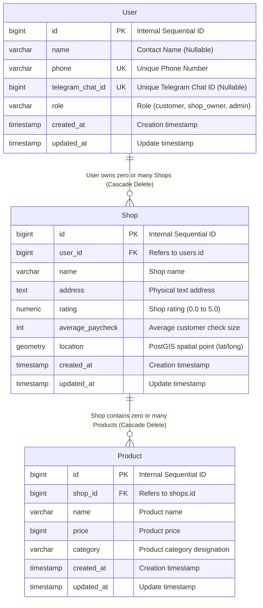

### Database Architecture

This is the Entity-Relationship Diagram (ERD) mapping the core tables in the Domix database.



### Auth via telegram bot
1. User presses create account in flutter app then he is prompted to choose to pick a role (show owner or customer) and write down his name first and family name, after it he presses "Verify through telegram" button.
2. Flutter app hits http point api/auth/init and sends a json containing gathered info: role, name.
3. Our backend receives this json data and generates random sessionID, after that using SessionManager's sync map called sessions, it links this sessionID with SessionData, like this:
```go
sm.sessions.Store(sessionID, SessionData{           
	Status:    "pending",               
	Name:      receivedName,                    
	Role:      receivedRole,                    
	CreatedAt: time.Now(),              
})      
```                                
4. Our backend sends telegram link and attaches to it sessionID to the flutter app, flutter app opens a telegram with that sessionID, sessionID is then send by telegram bot back to our backend with telegram's chatID.
5. Our backend using SessionManager's sync map called chatToSession, connects that sessionID with chatID, and this way we know who's phone number we will get from this particular chat.
6. After that we prompt a user to send his phone number, once he does that, telegram sends chatID along side his phone number to our backend, we check whether the user exists (if yes we check whether his role changed and edit it if needed), if he does we log in, if no we sign him up and generate jwt token and send it to the flutter app.

### Things to fix.
1. After registration through telegram completes, user can keep spamming /start and phone number button, we need to fix that.
2. How to handle role separation in app between shop owner and normal user.
3. Make jwt token live longer - one year

### RESET DB FOR TESTING LOCALLY
TRUNCATE TABLE users RESTART IDENTITY CASCADE;