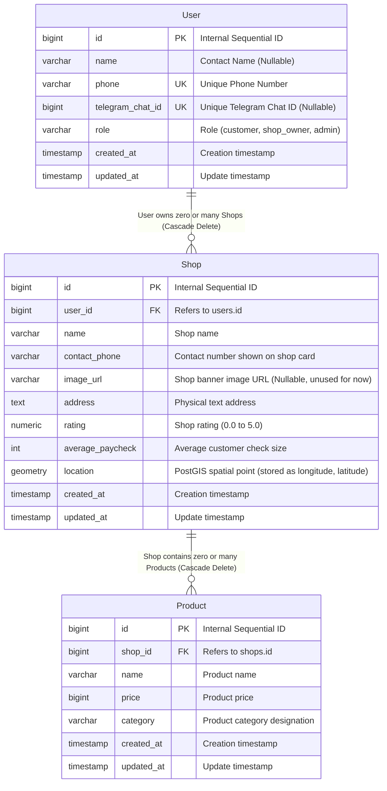

# Database

## Database Structure


## Database system design

### Connection pool

Our server-database communication is designed around *connection pool*, which is configured (inside backend/cmd/api/main.go - func mustConnectDB) the following way:
```go
config.MaxConns = envInt("DB_MAX_CONNS", 10) // max connections pool holds
config.MinConns = envInt("DB_MIN_CONNS", 2)  // minimum ready to use connetion, avoid cold-start latency
config.MaxConnLifetime = time.Hour           // connection that's been used longer than 1 hour should be cleaned
config.MaxConnIdleTime = 30 * time.Minute    // every connection that was not used at all gets cleaned
config.HealthCheckPeriod = time.Minute		 // every minute check on the connections and remove "bad" ones
```
Connection pool holds several ready to use connection to the database, creating a connection to the db takes time and effort, hence it is not very efficient, that is the reason it exists.

### Context ctx

In our backend we have a concept called "Context" AKA ctx, which is designed to signal that an operation should stop — either because it's been running too long, or because whoever asked for it gave up — so the code holding a connection can release it back to the pool instead of hanging onto it. We implemented our own ctx (func WithTimeout) inside backend/internal/dbctx/dbctx.go. Which takes a parent context and wraps around it adding a 5 second timer, this is the maximum time any sqlc-generated query is allowed to run before it's forced to stop and return an error

Parent context in this function means that we need to pass it an existing ctx which can be taken in two ways:
1. From incoming http requests (which are not timers, but rather guards that watch whether user e.g turned off his internet or left the app).
2. Or create ourselfs by using context.Background()


# Auth

Our authentication works around SessionManager struct, which contains two sync.Map, one called `session` for linking sessionID and data that we got from flutter app - name and role, this data is saved inside another struct named SessionData, another sync map called chatToSession links telegram chatID to sessionID. We used sync.Map deliberately to avoid race condition (two or more goroutines e.g from http requests trying to allocate a store inside one shared container), so sync.Map saves us from concurrency problem. Each sync map contains their entries, and i set up goroutines to watch those entries, if one of the entries in sessions sync.Map get older than 10 minutes it gets cleaned up, if user stuck in the telegram chat without sending a phone number, session and session data will be deleted after 10 minuets as i described above, which will create an orphaned chatToSession - chat id pointing to non existing session id, so the same goroutine cleans it up as soon as it cleand sessions entry.

### Auth via telegram bot backend flow
1. User presses create account in flutter app then he is prompted to choose a role (customer or shop owner) and write down his name, after that he presses "Verify through telegram" button.
2. Flutter app hits http point api/auth/init and sends a json containing gathered info: role, name.
3. Our backend receives this json data and generates random sessionID, after that using SessionManager's sync map called sessions, it links this sessionID with SessionData, like this:
```go
sm.sessions.Store(sessionID, SessionData{           
	Status:    "pending",               
	Name:      receivedName,                    
	Role:      receivedRole,                    
	CreatedAt: time.Now(),              
})      
```                                
4. Our backend sends telegram link and attaches to it sessionID to the flutter app, flutter app opens a telegram with that sessionID, sessionID is then send by telegram bot back to our backend with telegram's chatID.
5. Our backend using SessionManager's sync map called chatToSession, connects that sessionID with chatID, and this way we know who's phone number we will get from this particular chat.
6. After that we prompt a user to send his phone number, once he does that, telegram sends chatID along side his phone number to our backend, we check whether the user exists (if yes we check whether his role and name changed, if yes we edit it), if he does we log in, if no we sign him up and generate jwt token and send it to the flutter app.

### Auth via telegram bot flluter flow:
1. frontend/lib/features/profile/data/auth_service.dart - file that contains code for initializing handshake with go backend. It sends collected data to the backend, does polling to check the status of a login ticket and stores JWT and role inside user's hardware encrypted storage.
2. frontend/lib/features/profile/presentation/controllers/auth_controller.dart - file that orchestrates the whole auth process, by initializing authService, initializing handshake with backend, setting up pollling, based on the incoming output dictates how to render the page in profile section.


### LOCAL TESTING

- TRUNCATE TABLE users RESTART IDENTITY CASCADE;          
- ngrok http 8080                 
- flutter run --dart-define-from-file=env.json            
- go run backend/cmd/api    


### Things to work on

1. JWT token now does not contain role, which means some endpoints which require role identification now have to ask a db for the role based on the user's id, which adds additional db queries.